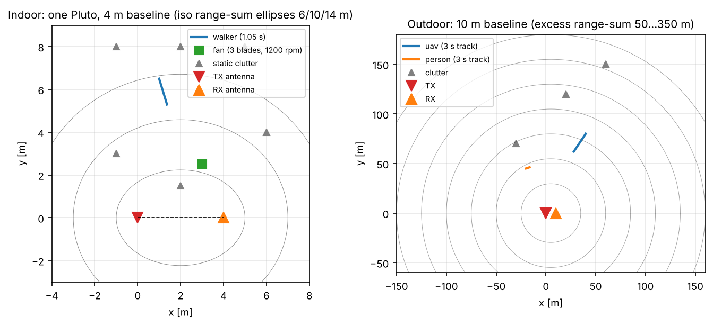
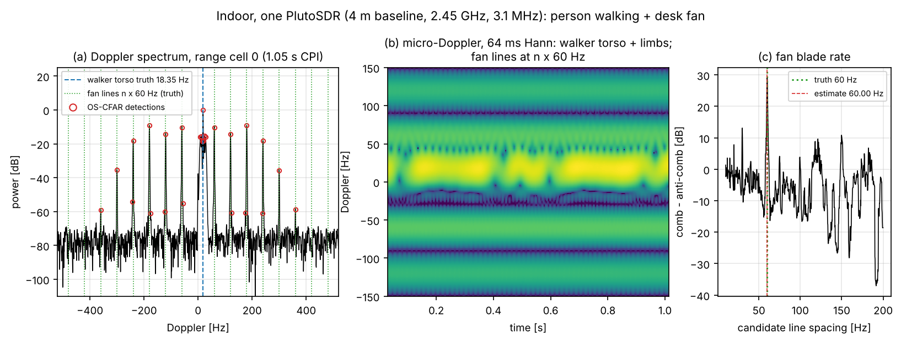
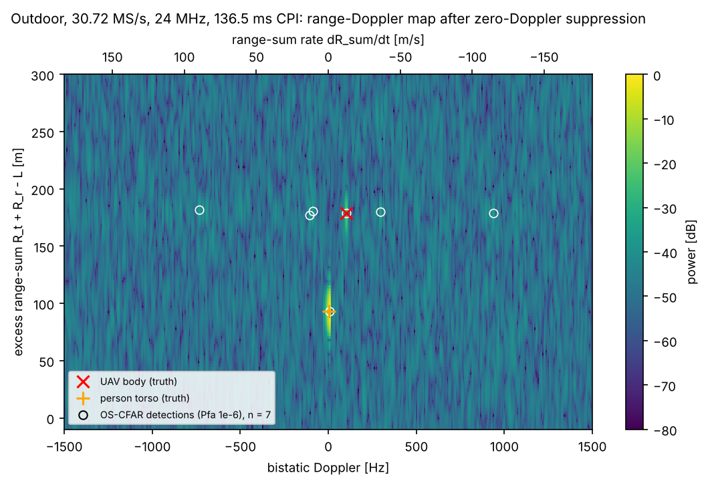
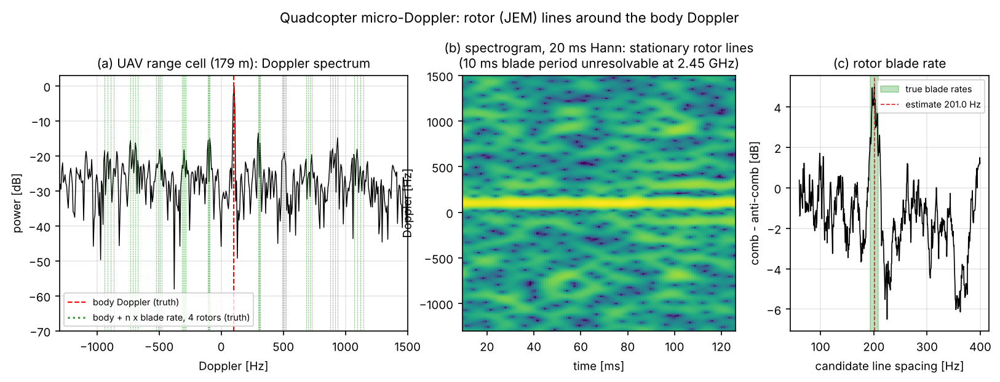
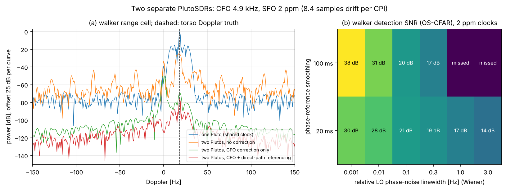
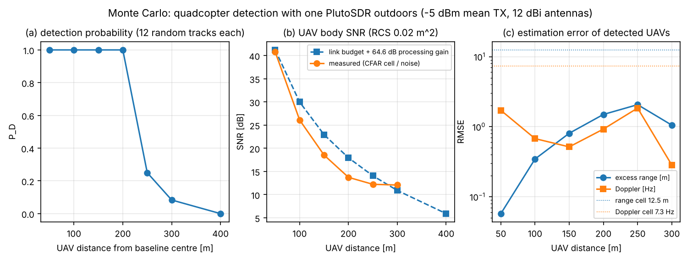

# Bistatic OFDM ISAC with a PlutoSDR and GNU Radio

**One OFDM waveform, two jobs:** it carries data (QPSK, decoded blindly at the receiver) and it illuminates the scene for a
bistatic radar that measures range-sum and Doppler, including the micro-Doppler of a rotating fan or a UAV's rotors.

Built for the ADALM-PLUTO (AD9363) with GNU Radio 3.10 (gr-iio), Python and, as an alternative receiver, SDR++.

> **Status.** The software is complete and tested (28 tests). The capture scripts and the GNU Radio flowgraphs are tested
> against simulated PlutoSDR drivers. The processing has been validated on simulated captures with a physical
> link budget and SDR impairments, and inside the GNU Radio 3.10 runtime. **No hardware measurement is reported yet.** The
> measurement plan is in [`docs/experiment_protocol.md`](docs/experiment_protocol.md); measured results will be added
> at the end of this file. Full technical report: [`report/ofdm_isac_report.pdf`](report/ofdm_isac_report.pdf).



## Quick start

```bash
# Ubuntu 22.04 / 24.04: GNU Radio 3.10 + gr-iio, libiio, Python deps, and a .venv with pyadi-iio
make setup && source .venv/bin/activate
make test          # 28 tests, about 2-3 min (the GNU Radio tests are skipped if GNU Radio is missing)
make demo          # no hardware needed: simulated capture -> report -> GNU Radio replay
```

If GNU Radio is installed for a different Python interpreter, pass it: `make demo GRPY=/usr/bin/python3`.

Other systems: install GNU Radio 3.10 with gr-iio (e.g. [radioconda](https://github.com/ryanvolz/radioconda) on Windows or
macOS), then `pip install -e .[hardware,test]` in the same environment.

### With one PlutoSDR (read [`docs/hardware_setup.md`](docs/hardware_setup.md) first)

```bash
make tx                                                   # TX buffers in tx/
python3 scripts/pluto_capture.py config/indoor.yaml --level-check --rx-gain 30 --tx-atten 10
python3 scripts/pluto_capture.py config/indoor.yaml --rx-gain <g> --tx-atten 10 --n-cpi 5 --label walk
python3 scripts/process_capture.py captures/<file>.sigmf-meta     # report + figures in results/captures/
cd grc && python3 pluto_isac_live.py                      # live view (or open the .grc in gnuradio-companion)
```

### With two PlutoSDRs, or SDR++ as the receiver

```bash
python3 scripts/pluto_capture.py config/indoor.yaml --tx-only --uri ip:192.168.2.1      # TX node
#   RX node: scripts/pluto_capture.py --rx-only, grc/pluto_rx_record.py, or SDR++ (see sdrpp/README.md)
python3 scripts/process_capture.py <recording> --config config/indoor.yaml --two-device
```

## What it does

```
TX (cyclic buffer) ─► scene ─► RX ─► contiguity check ─► frame sync ─► [CFO] ─► OFDM demod ─┬─► comm: preamble LS, CPE, QPSK ─► BER/EVM
                                                                                             └─► radar: H = Y / X̂ ─► [direct-path ref.] ─► zero-Doppler
                                                                                                 suppression ─► range-sum x Doppler ─► OS-CFAR ─► detections, micro-Doppler
```
(bracketed steps: two separate SDRs only)

* **Waveform:** CP-OFDM, QPSK, truncated Zadoff-Chu preamble per frame (frame 0 has its own root), 8 frames with different payloads in the Pluto's cyclic TX buffer.
* **Radar:** reciprocal-filter OFDM radar with a decision-directed reference, direct-path delay calibration, DC-subcarrier interpolation, ordered-statistic CFAR on independent training cells, peak interpolation, rotor line-spacing (blade-rate) estimator.
* **Two separate SDRs:** blind cyclic-prefix CFO estimate plus direct-path referencing (SFO and LO phase noise), with a quantified phase-noise tolerance.
* **Robustness:** sync-quality check, sample-drop detection (keeps the longest gap-free segment), BER-based warning that the radar reference is invalid, clipping warning.

## GNU Radio, SDR++ and Python tools

| Tool | Purpose |
|---|---|
| `grc/pluto_isac_live.grc` / `.py` | One Pluto: cyclic TX + RX → live Doppler display, RX spectrum, RX level [dBFS], detections (PMT messages) |
| `grc/pluto_tx_only.grc` / `.py` | TX node (two-Pluto set-up, or TX for an SDR++ receiver) |
| `grc/pluto_rx_record.grc` / `.py` | Records N samples to `.cf32` for offline processing |
| `grc/replay_isac.grc` / `.py` | Headless replay of a recording through the same embedded block (run by the tests) |
| `grc/isac_epy_block.py`, `grc/build_flowgraphs.py` | The embedded ISAC block, and the generator of all four flowgraphs (`make grc`) |
| `sdrpp/README.md` | SDR++ as the receiver of a two-Pluto set-up (baseband WAV recordings) |
| `scripts/pluto_capture.py` | pyadi-iio: level check, contiguous CPIs saved as SigMF, `--tx-only` / `--rx-only` |
| `scripts/process_capture.py` | Offline processing of SigMF, `.cf32` or SDR++ `.wav` (resampling, contiguity check, report) |
| `scripts/predict.py` | Ground truth helper: expected Doppler for a walk, a pendulum or a rotor |
| `scripts/run_simulation.py`, `scripts/make_results_table.py` | Simulation study, and the tables in this README and in `docs/theory.md` |
| `report/build_report.py` | The PDF report; every number in it is generated from `results/metrics.json` |

All flowgraph paths are relative to `grc/`: run the generated scripts from that folder.

## Operating points

| | Indoor (`config/indoor.yaml`) | Outdoor UAV (`config/outdoor_uav.yaml`) |
|---|---|---|
| Sample rate / occupied bandwidth | 4 MS/s / 3.14 MHz (continuous over USB 2.0) | 30.72 MS/s / 24.0 MHz (on-board cyclic TX, one-buffer RX) |
| FFT / CP / subcarrier spacing | 256 / 64 / 15.625 kHz | 1024 / 128 / 30 kHz |
| Range-sum resolution | 95.5 m (targets are separated in Doppler) | 12.5 m |
| CPI / Doppler resolution | 1.05 s / 0.95 Hz (0.117 m/s range-sum rate) | 136.5 ms / 7.33 Hz (0.90 m/s) |
| 2-D processing gain | 64.2 dB | 64.6 dB |
| Assumed mean TX power | -15 dBm (10 dB attenuation) | -5 dBm (0 dB attenuation) |

The TX power follows from the AD9363's 7.5 dBm maximum output (data sheet), the OFDM level (about 12 dB below full scale)
and the attenuation. It is an assumption until measured (experiment E0). Derivations: [`docs/theory.md`](docs/theory.md).

## Simulation results (ground truth known)

All numbers come from `results/metrics.json`, written by `scripts/run_simulation.py`.

<!-- RESULTS:BEGIN (generated by scripts/make_results_table.py) -->
| Scenario | Quantity | Truth | Estimate | Error |
|---|---|---|---|---|
| Indoor, person walking | torso Doppler | 18.35 Hz | 18.33 Hz | -0.018 Hz (-0.019 cells) |
| Indoor, desk fan (3 blades, 1200 rpm) | rotor line spacing | 60.0 Hz | 60.00 Hz | +0.00 Hz |
| Indoor | communication on the same CPI | BER 0 | BER 0e+00 over 5,115,600 bits, EVM -25.0 dB | |
| Outdoor, UAV body | excess range-sum | 178.89 m | 178.68 m | -0.21 m (-0.017 cells) |
| Outdoor, UAV body | Doppler | 103.34 Hz | 102.95 Hz | -0.40 Hz (-0.054 cells) |
| Outdoor, UAV rotors (4 x 2 blades) | rotor line spacing | 193.3 to 208.3 Hz | 201.0 Hz | inside the true spread |
| Outdoor, person (slow, 0.5 cell) | Doppler | 3.67 Hz | 6.97 Hz | +3.29 Hz (zero-Doppler notch bias) |
| Outdoor | communication | BER 0 | BER 0e+00 over 5,644,800 bits, EVM -24.9 dB | |
| Two Plutos (2 ppm, CFO 4900 Hz) | CFO estimate | 4900.0 Hz | 4900.01 Hz | +0.007 Hz |
| Two Plutos, no correction | link / walker | | BER 0.50, walker missed | |
| Two Plutos, CFO only (SFO uncorrected) | walker excess range | 8.48 m | 81.4 m | +73.0 m |
| Two Plutos, CFO + direct-path referencing | walker Doppler | 18.33 Hz | 18.31 Hz | -0.023 Hz, BER 0e+00 |
| Monte Carlo UAV (12 random tracks per distance) | P_D vs distance | | 50 m: 1.00, 100 m: 1.00, 150 m: 1.00, 200 m: 1.00, 250 m: 0.25, 300 m: 0.08, 400 m: 0.00 | |
<!-- RESULTS:END -->







## Defects found during development and review

Each one is covered by a regression test, and most are effects a hardware set-up also shows:

1. **ADC clipping → false Doppler lines at the TX-buffer rate.** The gain had been set on the direct path, but the indoor clutter is 9 dB stronger. Fix: gain staging on the total received power, and 8 different frames per buffer.
2. **Empty DC subcarrier → flat range pedestal at about -52 dB.** Fix: interpolate H at DC.
3. **Cell-averaging CFAR missed the walking person** (its own limb echoes filled the training cells). Fix: OS-CFAR on independent cells.
4. **The rotor-rate estimator locked onto 3x the fan rate.** Fix: anti-comb at several fractions.
5. **Frame sync could lock onto the next TX buffer.** Fix: search exactly one buffer, start at the first frame.
6. **GNU Radio scheduler stall** (`forecast()` asked for more than a buffer holds), found by running the flowgraph in the GNU Radio runtime.
7. **Review findings:** the TX power had been assumed about 10 dB too high (corrected; all results here use the corrected value); the digital TX level differed by 6 dB between the pyadi and GNU Radio paths; the RX gain range in the GUI was wrong (it is -3 to 71 dB at 1.3-4 GHz); the phase-noise conversion missed a factor of 2; a flowgraph variable depended on the working directory at compile time.
8. **Second review:** `make setup` failed on Ubuntu (pip pulled libiio-1.x bindings while Ubuntu ships libiio 0.25; the setup now uses Ubuntu's `python3-libiio`); minimum package versions forced pip to replace Ubuntu's numpy/matplotlib (lowered and tested on Python 3.10 / numpy 1.21 / scipy 1.8 / matplotlib 3.5 and on Ubuntu 24.04's Python 3.12); the RX-record flowgraph wrote into a folder that does not exist in a fresh clone; the capture script did not validate gain and attenuation before configuring the radio.

## Repository

```
isac/        config.py, waveform.py, receiver.py, radar.py, pipeline.py, channel.py (simulator),
             targets.py, geometry.py, scenarios.py, io.py (SigMF, cf32, WAV)
grc/         four flowgraphs (.grc + generated .py), isac_epy_block.py, build_flowgraphs.py
sdrpp/       SDR++ receiver guide
scripts/     pluto_capture, process_capture, make_sim_capture, generate_tx_buffer, predict,
             run_simulation, make_results_table, setup_ubuntu.sh
config/      indoor.yaml, outdoor_uav.yaml
docs/        theory.md, hardware_setup.md, experiment_protocol.md
report/      ofdm_isac_report.pdf and its generator
tests/       test_core.py (21), test_gnuradio.py (3), test_hardware_sim.py (4: scripts and flowgraphs against
             simulated PlutoSDR drivers in tests/fakes/)
figures/, results/, Makefile
```

## Limitations

* Indoors, the range-sum resolution is 95 m: targets are separated in Doppler only.
* Targets slower than about one Doppler cell are attenuated and biased by the zero-Doppler notch.
* One-Pluto mode shares one clock over cables (bistatic geometry, coherent clock). True two-node operation is supported and simulated; it needs `xo_correction` calibration.
* The simulator uses point scatterers and isotropic antenna gains. It does not model multipath, blade flashes, blade-tip ICI (about -23 dB relative to the blade echo), PA non-linearity or IQ imbalance.
* The TX power, noise figure, direct-path isolation and RCS values are assumptions (report: table of assumptions).
* The capture scripts and hardware flowgraphs are tested against simulated PlutoSDR drivers that enforce the real drivers'
  limits, but not yet on a real PlutoSDR. The SDR++ GUI procedure is untested.

## Measured results

To be filled from [`docs/experiment_protocol.md`](docs/experiment_protocol.md) (E0-E6).

| Experiment | Quantity | Truth | Measured | Error |
|---|---|---|---|---|
| E0 | mean TX power at 10 dB attenuation | | | |
| E3 | torso Doppler, walk towards | | | |
| E4 | fan rotor line spacing | | | |

## References

* C. Sturm, W. Wiesbeck, "Waveform design and signal processing aspects for fusion of wireless communications and radar sensing," *Proc. IEEE*, 99(7), 2011.
* J.-J. van de Beek, M. Sandell, P. O. Börjesson, "ML estimation of time and frequency offset in OFDM systems," *IEEE Trans. Signal Process.*, 45(7), 1997.
* H. Rohling, "Radar CFAR thresholding in clutter and multiple target situations," *IEEE Trans. Aerosp. Electron. Syst.*, 19(4), 1983.
* V. C. Chen, *The Micro-Doppler Effect in Radar*, Artech House, 2011.
* Analog Devices, AD9363 data sheet (Rev. D); [ADALM-PLUTO transmit notes](https://wiki.analog.com/university/tools/pluto/users/transmit).
* [SigMF specification](https://sigmf.org).

Author: Amirreza Piri. MIT License.
